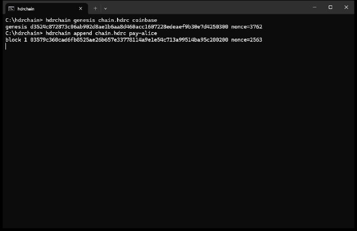
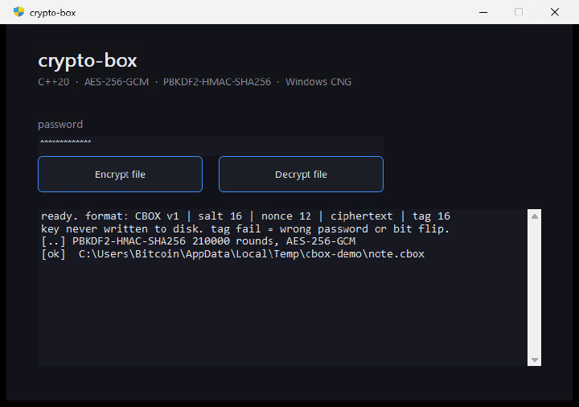
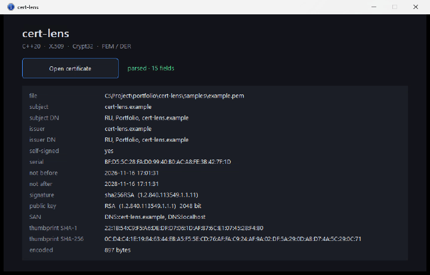
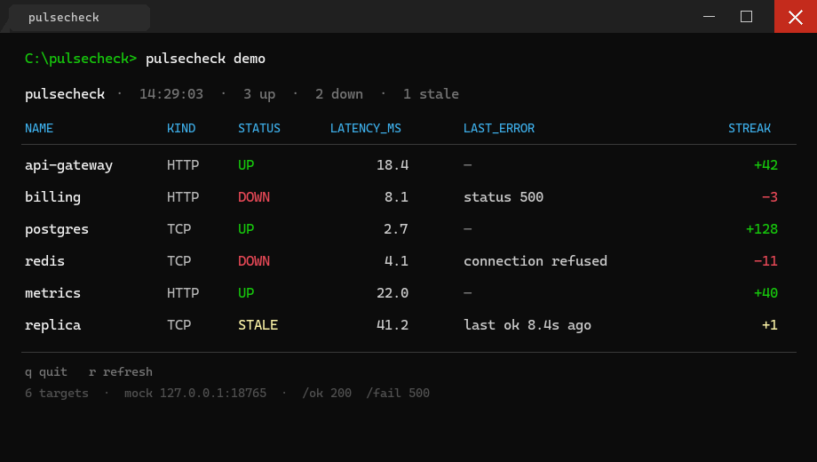
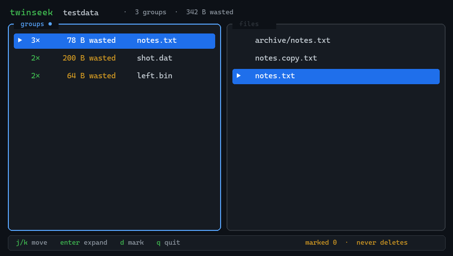
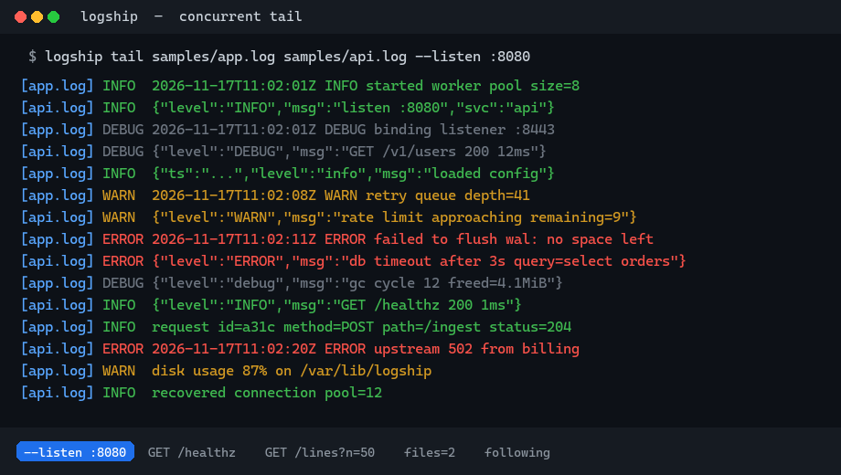
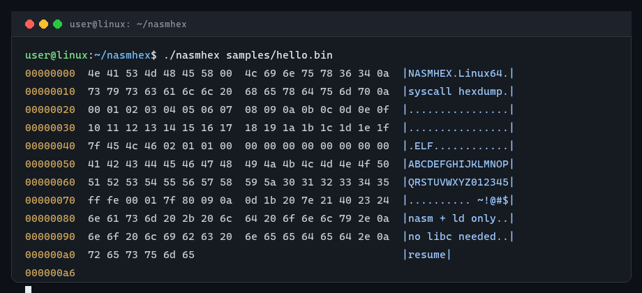
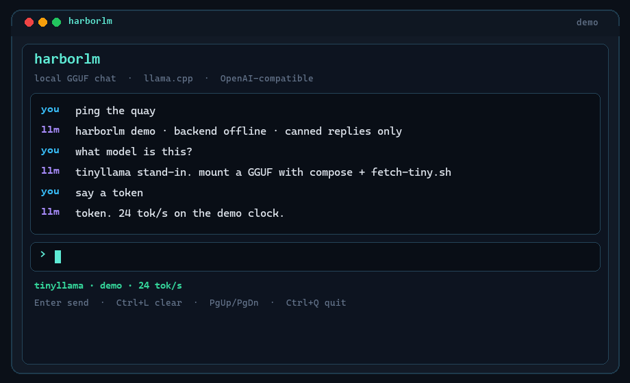
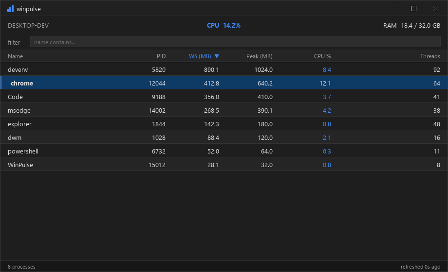

  

<h1 align="center">Артем Туманов</h1>

  C++20 · Windows 11 · Linux · macOS 
  <a href="https://gwbbej9-byte.github.io"><b>сайт с демо и скачиванием</b></a>
  ·
  <a href="https://hh.ru/resume/e9197460ff115e6e080039ed1f444e724438337"><b>резюме на HeadHunter</b></a>

  
  

все репозитории здесь — **для показа**. снял с пк то, что уже писал, выложил, чтобы было видно минимум стека: сборка, код, как закрываю одну задачу.

скрин — как выглядит запуск. скачать рабочий бинарь: [gwbbej9-byte.github.io](https://gwbbej9-byte.github.io)

пишу и собираю со **стационарного ПК, Windows 11**. Linux в репо — через Docker на этой же машине.

ядро — **трио на C++20**. остальное — тот же показ на других языках, если вакансия не про C++.

## стек

  

| слой | чем |
|---|---|
| ядро | C++20, Win32, CMake, MSVC |
| крипт | SHA-256d, Merkle, compact-bits PoW, AES-256-GCM, X.509, CNG / Crypt32 |
| ещё языки | Python, Rust, Go, C# / .NET 8, NASM x86-64 |
| среда | Windows 11, Linux (Docker) |

## проекты

скрин — интерфейс в запуске.

<table>
<tr>
<td width="33%" valign="top">

### [hdrchain](https://github.com/gwbbej9-byte/hdrchain)

C++20. SHA-256d, Merkle, PoW, `HDRC1`.

</td>
<td width="33%" valign="top">

### [crypto-box](https://github.com/gwbbej9-byte/crypto-box)

C++20 Win32. AES-256-GCM, PBKDF2 210000.

</td>
<td width="33%" valign="top">

### [cert-lens](https://github.com/gwbbej9-byte/cert-lens)

C++20 Win32. X.509, Crypt32, PEM / DER.

</td>
</tr>
<tr>
<td width="33%" valign="top">

### [pulsecheck](https://github.com/gwbbej9-byte/pulsecheck)

Python asyncio. HTTP + TCP health, Rich TUI.

</td>
<td width="33%" valign="top">

### [twinseek](https://github.com/gwbbej9-byte/twinseek)

Rust. дубликаты SHA-256, ratatui. `d` только метка.

</td>
<td width="33%" valign="top">

### [logship](https://github.com/gwbbej9-byte/logship)

Go. concurrent tail, цвет по уровню, `/healthz`.

</td>
</tr>
<tr>
<td width="33%" valign="top">

### [nasmhex](https://github.com/gwbbej9-byte/nasmhex)

NASM x86-64 Linux. `hexdump -C`, без libc.

</td>
<td width="33%" valign="top">

### [harborlm](https://github.com/gwbbej9-byte/harborlm)

Linux, local GGUF. llama.cpp + TUI. `--demo` без весов.

</td>
<td width="33%" valign="top">

### [winpulse](https://github.com/gwbbej9-byte/winpulse)

.NET 8 WinForms. процессы, CPU %, RSS.

</td>
</tr>
</table>
